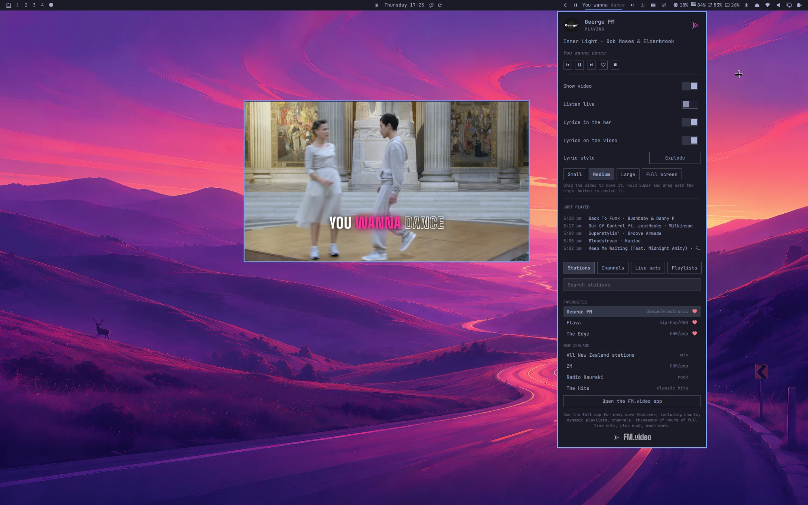
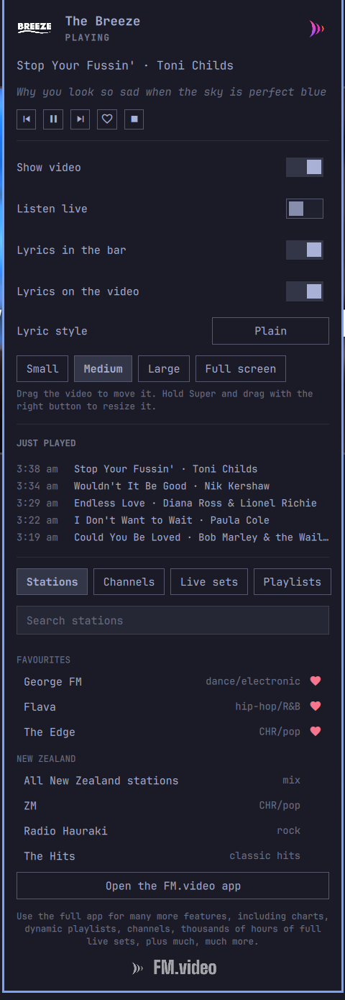
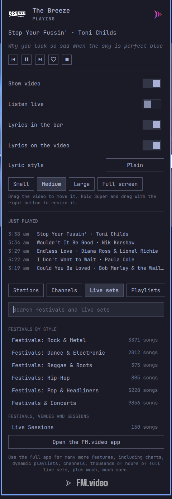
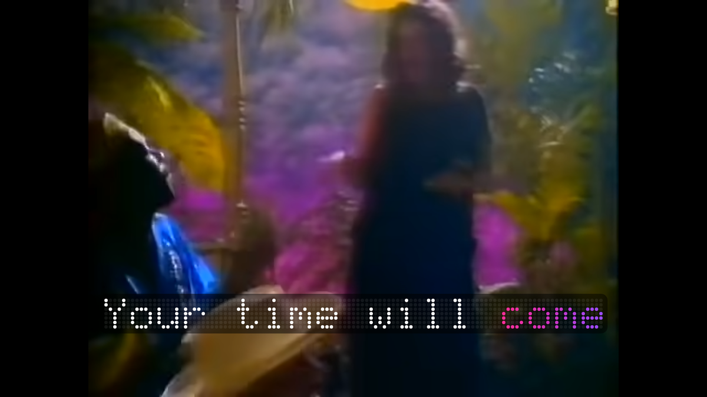
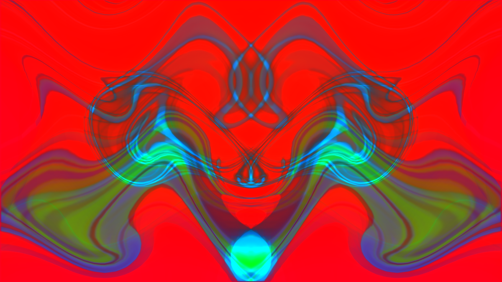
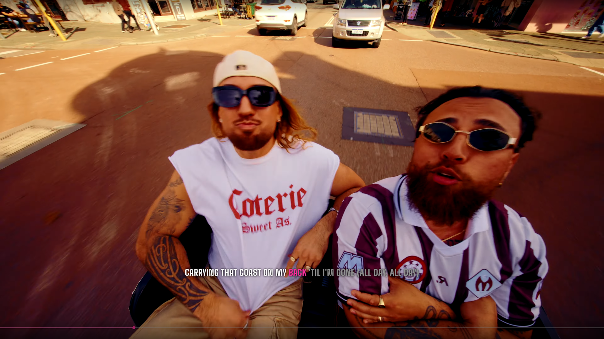

# FM.video for Omarchy

**Your favourite radio stations as nonstop music videos, ad-free, right in your Omarchy bar.**

Pick from over 200 stations around the world and watch what they are playing in a small window that floats above your work. Sing along as karaoke lyrics light up word by word. Listen live with a MilkDrop visualiser, or dive into thousands of hours of festival sets, concerts, channels and playlists. Free, with no account needed.



```bash
omarchy plugin add https://github.com/0800tim/fm-video-omarchy.git --enable
```

[FM.video](https://fm.video) turns radio stations into music video channels. This plugin puts it in the [Omarchy](https://omarchy.org) bar. More about it at [plugin.fm.video](https://plugin.fm.video).

## What you get

- **Radio you can watch.** The songs a station plays, back to back as music videos, ad-free. Skip any song you like.
- **The song in your bar.** The song a station is playing now, with play, pause and next.
- **Karaoke in the bar.** When a song has timed lyrics, the bar shows the line being sung and the words light up as they are sung.

  

- **A small video window.** The music videos play in a little window that floats on top of your other windows and follows you to every workspace. Drag it where you like. Make it bigger, or fill the screen.
- **Over 200 radio stations.** Your country first, then your neighbours. Search by name, style, city or country, and heart your favourites to keep them at the top.
- **Listen live.** Hear a station's own broadcast, with a visualiser if you want one, or with nothing on screen at all.
- **Thousands of hours of live sets.** Glastonbury, Coachella, Tomorrowland, Boiler Room, Red Rocks, MTV Unplugged and dozens more festivals, venues and sessions.
- **Channels and playlists.** Music by style and decade, and playlists other people have made.
- **Lyrics on the video in eight styles**, from plain to a dot matrix sign.

| Stations | Live sets |
|---|---|
|  |  |

| Dots lyric style | Listening live |
|---|---|
|  |  |

## What you need

- Omarchy 4 (the Quattro shell, with Hyprland's Lua config). Built and tested on Omarchy 4.0.4.
- A Chromium kind of browser. Omarchy ships Chromium. Chrome, Brave, Edge, Vivaldi and Helium work too if one of them is your default browser.
- `curl` and `jq`. Omarchy ships both.

## Install

```bash
omarchy plugin add https://github.com/0800tim/fm-video-omarchy.git --enable
```

The widget goes at the right hand end of the bar. To move it:

```bash
omarchy bar move plugin.fm.video --section left
```

## Remove

```bash
omarchy plugin remove plugin.fm.video
```

That removes the plugin. It leaves one folder behind, `~/.local/state/fmvideo-omarchy`, which holds your last station, your favourites, where you put the video window, and the browser profile the window uses. Delete it if you want nothing left:

```bash
rm -rf ~/.local/state/fmvideo-omarchy
```

If you used the **Install the FM.video app** button, take the app out with `omarchy-webapp-remove FM.video`.

The plugin never edits your Hyprland config or any other file of yours.

## Using it

### In the bar

| Where | Click | What happens |
|---|---|---|
| The icon | Left | Starts the video. Once it is going, plays and pauses. |
| The song | Left | Opens the panel. |
| The arrow | Left | Next song. While you listen live, the next station. |
| Anywhere | Right | Opens the panel. |
| Anywhere | Middle | Shows or hides the video window. The music carries on. |

### In the panel

- **Play, pause, next and previous.** While you listen live, next and previous change station.
- **The heart** beside them adds the song on now to your FM.video favourites. The first time, FM.video asks you to sign in, inside the video window. The plugin never sees your sign in.
- **Stop**, the square, closes the window and stops the music.
- **Show video** shows or hides the video window. Hidden, it keeps playing, so you can have the music without the picture. While you listen live it reads **Show visualiser**.
- **Listen live** plays the station's own broadcast in place of its music videos, for stations that have one.
- **Lyrics in the bar** shows the line being sung in place of the song name.
- **Lyrics on the video** shows the line over the video as well, and **Lyric style** picks its look. Click the button for the next style, right click for the one before.
- **Small, Medium, Large, Full screen** set the size of the video window.
- **Just played** lists the station's last five songs. Click one to watch its video.
- **Stations, Channels, Live sets, Playlists** are tabs. Pick anything in them to play it. Type to search, use the up and down arrows, and press Enter. The panel stays open so you can click through and see what each station is playing. Click outside it, or press Escape, to close it.
- **Hearts on stations.** Point at a station and click its heart to make it a favourite. Favourites are listed first.
- **Install the FM.video app**, at the bottom, adds the full FM.video site to your app launcher as an app of its own and opens it on what you are playing. The mini player stops, so the two do not play at once. The FM.video marks at the top and bottom of the panel do the same.

### The video window

Drag the window to move it. To resize it by hand, hold Super and drag with the right button. It opens in the same place next time.

With the window in front, its own keys work too:

| Key | What it does |
|---|---|
| Space | Play and pause |
| N, P | Next and previous |
| S | Pick a station |
| V | Switch between live radio and the videos |
| L | Lyrics on the video, on and off |
| T | The next lyric style |
| `[` and `]` | Lyrics a little later or sooner, when they are out of time |
| C | YouTube's own captions, on and off |
| H | Add the song to your favourites |
| F | Full screen |
| M | Mute |



## Settings

Add these to the plugin's entry in `~/.config/omarchy/shell.json`, or use `omarchy bar set`:

| Setting | Default | What it does |
|---|---|---|
| `maxLength` | `56` | The longest text the bar will show, in letters. |
| `showSongWhenClosed` | `true` | Show what the station is playing while the player is stopped. Set to `false` for just the icon. |
| `hideExplicitLyrics` | `false` | Keep the lyrics of songs marked explicit out of the bar. |

```bash
omarchy bar set plugin.fm.video maxLength 40
```

## Keyboard shortcuts

The plugin answers these commands, so you can bind keys to them in your Hyprland config:

```bash
omarchy-shell plugin.fm.video toggleWindow     # show or hide the video
omarchy-shell plugin.fm.video playPause
omarchy-shell plugin.fm.video next
omarchy-shell plugin.fm.video previous
omarchy-shell plugin.fm.video stop
omarchy-shell plugin.fm.video station george
omarchy-shell plugin.fm.video channel glastonbury
omarchy-shell plugin.fm.video playlist <its share code>
omarchy-shell plugin.fm.video favourites
omarchy-shell plugin.fm.video live true
omarchy-shell plugin.fm.video size medium      # small, medium, large or full
omarchy-shell plugin.fm.video barLyrics true
omarchy-shell plugin.fm.video videoLyrics false
omarchy-shell plugin.fm.video lyricStyle dots  # plain, dots, blocks, sparkle, explode, outline, typewriter, wave
omarchy-shell plugin.fm.video favouriteSong
omarchy-shell plugin.fm.video openApp
omarchy-shell plugin.fm.video tab sets         # stations, channels, sets or playlists
omarchy-shell plugin.fm.video status
```

For example, in `~/.config/hypr/bindings.lua`:

```lua
hl.bind("SUPER + ALT + M", hl.dsp.exec_cmd("omarchy-shell plugin.fm.video toggleWindow"))
```

## How it works

There are three pieces.

1. **The video player** is a web page, [fm.video/mini](https://fm.video/mini). The plugin opens it in a browser window with no tabs or address bar, and asks Hyprland to float it and pin it. It is a web page on purpose: YouTube only allows its videos to play in its own embedded player, which needs a browser. The plugin never downloads or extracts video or audio.
2. **The data** comes from the FM.video API: the list of stations, what each one has played, channels, playlists and lyrics.
3. **The plugin** is the part in this repository.

| File | What it is |
|---|---|
| `Service.qml` | Runs once in the background and holds everything the bar needs. |
| `BarWidget.qml` | What you see in the bar, with its panel. |
| `Model.js` | The logic that needs no desktop. `tests/model.test.mjs` tests it. |
| `Constants.js` | Addresses and the API key. |
| `scripts/fmv-window` | Opens, sizes, hides and closes the video window. |
| `scripts/fmv-drag.lua` | Lets you drag the window with a plain drag. |

**Knowing what is playing.** The window's title says the song, the artist and the station, and the plugin reads it. The position in the song comes from the desktop's media controls (MPRIS), which keeps the lyric line in time.

**Telling the window what to do.** Play, pause and next go to the page as key presses. A change of station or song goes through the FM.video server, to a code made up on your machine that only your window listens on, so the window changes without reloading. If that fails, the plugin reopens the window in the same place.

**Hiding the window** moves it to a Hyprland workspace that is never shown (`special:fmvideo`). It is still open there, which is why it keeps playing.

**Dragging** works through `scripts/fmv-drag.lua`, which the plugin loads into Hyprland when the video window opens. It watches the left mouse button and moves the window only when the press lands on the FM.video window. Clicks still go through to whatever is under the pointer, and no other window is affected. It stays loaded until the next Hyprland reload, and does nothing while no FM.video window is open. To switch it off by hand: `hyprctl eval 'fmvideo_drag.unload()'`.

**Lighting the words.** Nothing times single words, so the lit part of a lyric line is worked out from how far the song is between this line and the next.

The video window has a browser profile of its own, kept apart from your normal browsing.

## What it sends over the network

- **Requests to `api.fm.video`** for stations, plays, channels, playlists and lyrics, and one request to learn your country so your stations come first. The bar asks every 40 seconds while the video or the panel is open, and every two minutes otherwise. When the plugin is turned off it asks for nothing.
- **Commands for your video window**, such as a change of station, which go through `api.fm.video` to your window.
- **One request the first time the plugin runs, to register an install id.** FM.video uses it to count installs and to stop one that misbehaves. It is anonymous: FM.video keeps the id (as a hash), the plugin's version, the country the request came from, and dates. No name, no address, no IP address. The id is kept in `~/.local/state/fmvideo-omarchy/install-token`, readable only by you, and sent with every request.
- **Station logos** from `fm.video`.
- **Everything the video window loads**, which is the FM.video page and YouTube's player.

The API key in `Constants.js` is public on purpose. It can only read what the website already shows, and the server limits how often anyone can use it. It is for this plugin only, so please do not use it for anything else.

No code is ever loaded from the network. Only data.

## What is still rough

- **The lyric line can run ahead or behind** on some songs, when the video is a different cut from the one the lyrics were timed to. Use `[` and `]` in the video window to nudge it. Many songs have no timed lyrics at all, and then the bar shows the song name.
- **Live radio has no lyrics.** They are timed to the video, not the broadcast.
- **Your own playlists** are not listed. The Playlists tab shows public ones, and Your favourites.
- **An upright bar** (on the left or right edge) shows only the icon. Click it for the panel.
- **Only tested on Hyprland 0.56 with Omarchy's Lua config**, on one machine. Older Hyprland configs will not float or pin the window.
- **Firefox is not supported** for the video window. If your default browser is not a Chromium kind, the plugin uses Chromium.
- **The video window's browser profile takes disk space**, a few hundred megabytes after some use, in `~/.local/state/fmvideo-omarchy/browser`.

## If something is not right

- **No sound when the window opens.** Click the video once. Browsers sometimes hold sound back until you do.
- **The window is tiled, not floating.** Your Hyprland is not using the Lua config. Omarchy 4 does.
- **The bar shows nothing.** Run `omarchy-shell plugin.fm.video status`. If `error` says FM.video cannot be reached, check your connection.
- **After changing the plugin's files nothing changes.** Run `omarchy restart shell`.

## Working on it

```bash
tests/run                       # test the logic and check the manifest
tools/dev-sync                  # copy this checkout into ~/.config/omarchy/plugins
omarchy restart shell           # load the new code
```

The shell notices changed files by itself, but it does not always let go of the old code, so restart it to be sure.

One thing to know before changing `scripts/fmv-drag.lua`: never call `remove()` on a Hyprland key bind. It crashes Hyprland 0.56.2. The file explains what it does instead.

## Licence

MIT. See [LICENSE](LICENSE).

The FM.video name and logo (the files in `assets/`) are FM.video's brand and are not covered by the MIT licence. They are here so the plugin can show them.

FM.video is not connected with YouTube or with any of the radio stations. Videos play through YouTube's own player.
